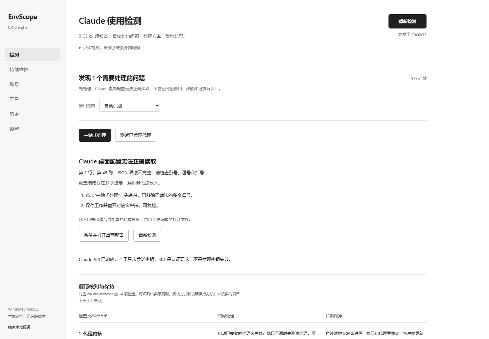

# EnvScope



A minimal Windows/macOS desktop environment toolkit. Alpha v0.4.0.

Each of the 14 upstream Claude checks now has an observation, measurement scope,
remedy and upkeep plan. Reviewed user-scoped Windows tasks / macOS LaunchAgents
can run native checks every 5, 15 or 60 minutes. Optional Code config recovery
preserves unrelated current settings, makes private backups and pauses repeated
rewrites. Undo verifies hashes across restarts. Browser ICE and account login are
never inferred from scheduled native checks. Real OS task lifecycle, permissions
and sleep/resume acceptance remain pending; tests use injected schedulers.
See [the source-mapped checklist and upkeep implementation](docs/CLAUDE_CHECKS.md).

The page explains specific problems, observations, causes and ordered next steps
without requiring raw JSON. A reviewed solution plan can repair deterministic
trailing commas, verify and set a local HTTP(S) proxy for Claude Code, remove
matching Code bypass entries and restore Code TLS verification. Original files
are backed up before atomic replacement. Fresh audits distinguish confirmed
resolution from missing evidence; hash-verified undo across restarts preserves later edits.

Backups in `~/.envscope/config-backups` are unencrypted and can contain secrets.
They remain local, are excluded from diagnostic exports and survive exit. Plans
are short-lived and bound to the current native report; history/imported reports
cannot authorize writes. Other problems have fixed file/settings entries and
concrete instructions. Organization access, trusted enterprise CAs and remote
service failures require their respective owner.

[Desktop downloads](https://github.com/qudadd/envscope/releases): Windows x64,
macOS Apple Silicon and Intel. Alpha packages are not commercially signed/notarized.

Based on the complete pinned functionality of
[claude-switcher](https://github.com/YOURSJEYO/claude-switcher), with independent
measurements, guarded transactional accounts, diagnostics and maintenance.
Scrapling is used only for source research, never at runtime.

```sh
python -m envscope audit                           # offline inventory
python -m envscope audit --online --stun --ipv6    # explicit public probes
python -m envscope desktop                         # opens one-click desktop UI
```

Python 3.10+ and system curl for online CLI probes. No Python runtime packages.
The desktop UI has no third-party scripts. Windows and macOS are the target
platforms; mobile adaptation is deferred. Double-click the desktop app, then
click the single test button. Native and browser observations merge automatically.
Windows has been built and locally checked. Automated rules and packaging checks
pass on Windows, Linux and macOS; browser interaction checks also pass.
macOS apps are built for Apple Silicon and Intel. Real installation, account
sessions, maintenance permissions and Safari validation remain pending.

The five minimal pages cover diagnostics, accounts, tools, history and settings.
One-click auditing includes 14 baseline categories and 18 additional checks, with
specific explanations, direct remedies and a before/after repair review.
Added checks cover system DNS and selected routes, hosts overrides, system/env
proxy differences and bypasses, configured loopback listeners, TUN/controller
configuration, TLS verification, DNS/TCP/TLS/TTFB timings, HTTPS-date clock
comparison, desktop/profile/config discovery, CLI entry/config conflicts, disk
capacity and account-transaction integrity. Each check states its limits.
Native additions include verified staged account copies and rollback, dynamic
slots and labels, fresh launch preflight, proxy discovery without port scanning,
explicit-proxy connectivity and timing, a 50-report redacted history with private
HMAC comparisons, support bundles and preference restoration. Windows adds
read-only CLI-path and device/font inventory; browser Canvas/WebGL information
is collected only when requested and stays in the page.

All 57 tracked upstream files are pinned and retained with their MIT license.
Fixed adapters expose installed upstream maintenance: installation, repair,
guard/routing setup, status/checks and core updates on both target platforms;
region/client changes, temporary browsers and encrypted DMGs on macOS.
Unsupported or missing commands are disabled. Installer launch means started,
not installed. Original reported results never become independent probe passes.
See the exact [platform matrix](docs/FEATURE_PARITY.md).

Detection is read-only. Account switching and installed-system actions require
separate explicit clicks and confirmation. Interrupted account transactions
preserve recovery copies and refuse new writes; automatic power-loss recovery
is not implemented. Directory backups are **unencrypted** and are not support
bundles. Local copying does not guarantee cross-OS or server-session migration.
Never use both account managers concurrently. Upstream updates affect only its
installed core; EnvScope has no whole-product automatic updater.

- A timeout, missing IPv6 response, mDNS candidate, or relay-only ICE result is
  **unknown**, never proof of protection.
- Native UDP STUN and browser WebRTC are separate measurements.
- IPv4 and IPv6 have separate allowlists. An unexpected address is a policy
  violation only when the allowed range was explicitly configured.
- 401, 403, 429, and server errors are reported distinctly.
- Imported upstream verdicts are not trusted. Imported browser snapshots must
  be raw, complete, and recent; they are user-supplied, unsigned observations.
- Reports redact addresses by default. Interface presence, Fake-IP, successful
  DoH, and a running proxy are not proof of a protected traffic path.

Authoritative DNS observation, per-process traffic correlation, and firewall
protection are not implemented in this release. The default privacy profile
therefore reports **incomplete**. The transport profile intentionally limits the
required scope to HTTP egress. No result is a zero-leak or account-safety promise.

Exit codes: 0 clear within configured scope; 1 explicit policy/target mismatch;
2 incomplete/review; 3 invalid input or unavailable local resource.

See the [Chinese README](README.md) for proxy settings, browser snapshot import,
private policies, reports, tests, and the implementation roadmap. Licensed under
MIT; origins and integration boundaries are in [third-party notices](THIRD_PARTY_NOTICES.md).
