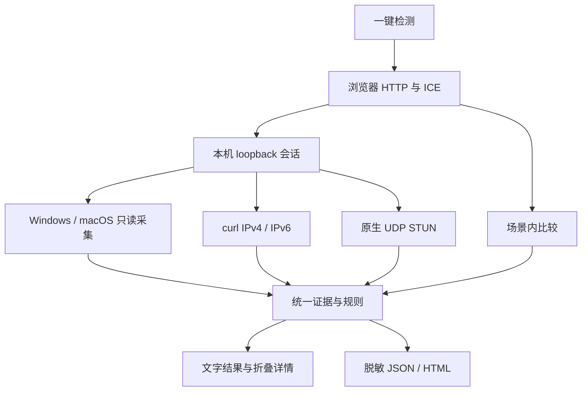

# 检测架构

0.6 在只读审计之后自动调用服务器拥有的方案生成器。Code 配置完善根据实际使用范围
选择固定目标，优先核对当前本机 HTTP 代理；显式选择不回退其他候选。自定义接口、
云平台及未明确更换的远程代理不自动改路。每个配置变更仍须布尔确认、备份和 CAS。
写入前再次验证代理，并比较继承环境指纹。复检新读文件后只公开字段名、范围和结果，
不把配置哈希或原文放进报告。页面把方案、确认、复检及长期保持串成同一流程。

0.4 增加 `claude_checks.py` 的 14 项来源映射、处理与保持清单。
`maintenance.py` 将系统后台调度、独立原生巡检、事件、批准字段恢复和心跳
组成可启停流程；`scheduler.py` 只注册固定的当前用户 worker。
详见 [逐项检测与持续维护](CLAUDE_CHECKS.md)。后台与前台不共享浏览器观测；
两者写同一配置时仍使用同一配置文件 OS 锁及内容比较。

## 使用流程

Windows 双击 `EnvScope.exe`，macOS 双击 `EnvScope.app`。本机服务启动并打开默认浏览器。用户点击“一键检测”，页面自动合并系统与当前浏览器观测，可导出一份隐藏地址的结果。

源码入口为 `start-windows.cmd` / `start-macos.command`，需要 Python 3.10+。桌面打包版本自带 Python 运行时，不包含 Scrapling。当前 Windows 打包已在本机验证；macOS 的采集代码及构建流程已准备，真机验证另行记录。

不提供手机端适配。界面使用桌面单列布局、黑白文字、细分隔线和折叠详情。没有分数、卡片、装饰图标或大幅口号。

## 数据流

Scrapling 位于开发前的资料采集阶段，不在上述运行链路中。

0.2 另有 18 项扩展检查。HTTP 请求并行采集经校验的 TLS 与分段耗时，只保留 Date / Age 派生的时差，不保留响应头或 Cookie。系统解析和选路在独立 worker 中执行，父进程有 16 秒硬截止；每个目标及地址族最多取一个解析地址进行选路查询。Windows 使用只读 `Find-NetRoute`，macOS 使用只读 `route -n get`。

本机配置采集只导出存在性、格式、数量和冲突标记，不导出凭据、MCP 参数或其他 hosts 内容。监听探测仅连接最多 4 个现有配置中的 loopback 端口；不扫描，不执行 PAC / WPAD 或 CLI 候选文件。可选项目未配置时标为未检测。

## 观测和规则

每个检查有独立 ID、状态、摘要、作用范围、证据列表和局限说明。HTTP 证据保留端点、来源、时间、地址族、路径及响应状态。原生 UDP 不用作浏览器 ICE 的替代品。

状态为 `pass`、`warn`、`fail`、`unknown`、`skipped`。规则优先级：

1. 观测地址超出用户明确配置的允许网段：策略违反。
2. 所需检查不存在、无响应、格式异常、过期或未完成：不完整。
3. 有效来源不足或场景内地址不一致：复核。
4. 所有必需项有足够证据：配置范围内通过。

默认隐私范围包含原生 HTTP IPv4、IPv6、UDP、浏览器 WebRTC 与 DNS。权威 DNS 观测未实现，因此首版不会给出完整隐私通过结论。`transport` 范围仅要求 HTTP 出口交叉验证，其他未知项仍显示。

IPv4/IPv6 分开比较。允许多个合法出口。没有明确的允许网段时，地址不一致只能提示差异，不能认定哪个地址是真实 IP。TURN relay 地址不作为客户端公网地址；仅有 mDNS、私网或 relay 时保留未知。

## 桌面服务与本机状态

- 只绑定 `127.0.0.1` 的随机端口。
- 同源页面获取随机会话令牌；POST 同时验证 Host、Origin 与令牌。
- `/api/audit` 只接收浏览器原始观测。`/api/action` 接收固定动作 ID、逐动作验证的参数和布尔确认，不接受可执行路径、Shell、命令字符串或任意进程参数。
- `/api/catalog` 也需要会话令牌，提供当前平台能力、安装状态、账号和历史元数据；发现代理只读取现有配置，不扫描端口。
- 请求体最多 64 KiB；检测与动作共用单任务锁；不开放跨域访问。
- 在内存中评估原始地址，仅将脱敏报告和私有 HMAC 集合标记写到 `~/.envscope`，保留最近 50 次。目标偏好有上一次版本可恢复。
- 页面提供“结束本地服务”；桌面进程闲置 15 分钟后退出。检测前不请求公共端点。

令牌用于防止其他网站意外调用本机探测，不用于抵御已经掌握本机用户权限的程序。浏览器观测未签名，不能作为可信远程审计凭证。

## 超时和失败

curl 有连接和请求总超时，不跟随重定向，不加载用户 `.curlrc`。显式代理失败不尝试另一条路径。STUN 在独立子进程运行，DNS 解析与 UDP 请求共用硬截止时间；冻结程序也使用独立 worker，避免启动浏览器递归。

STUN 验证消息类型、magic cookie、transaction ID、消息长度、属性边界、IPv4/IPv6 映射，以及存在时的 FINGERPRINT。它仍是未经服务端认证的 UDP 测量，不能对抗所有中间人场景。

## 账号与维护

原生 14 类检查保留上游分类，独立测量项另列。运行规则会读取 loopback `/configs`、`/rules`、`/proxies`，核对 13 个域名、3 个 STUN 端口的顺序与目标、启用状态、当前选中节点和 UDP 能力；运行配置本身仍不能证明实际流量路径。

守护任务必须同时处于已注册、已启用和运行状态才在该范围通过，注册后停用 / 未运行不会获得通过。0.3 的 `diagnosis.py` 将完整观测转成问题、正常响应、参考信息与能力缺口；隐私策略和启动条件继续使用完整观测，不能由页面诊断标题替代。

`remedies.py` 提供固定文件的窄范围修改、私有备份、逐文件原子替换、跨进程锁、会话内撤销与 90 秒单次方案。`solution-plan` 和文件入口必须引用当前服务报告 ID；`solution-apply` 只接受服务器生成的方案 ID 与严格布尔确认。重检比较问题与显式验证状态，缺失证据不算消除。安装器的异步状态需单独等待用户完成后复检。

`diagnosis.mjs` 直接展示事实、原因和处理步骤，支持审核方案、执行、自动复检和撤销。页面不再渲染原始 JSON 或通用“查看详情”。完整脱敏观测保留在导出中；HTML 与 CLI 同样先报告问题与处理步骤。

`Operations` 统一处理日常操作。账号交换、应用打开与原版临时浏览器均调用服务端重新检测，不能用导入报告或界面上一次显示的通过结果授权。浏览器观测最多 5 分钟，仍按原有时间和作用范围解释；原生测量在操作前重新执行。

`AccountManager` 沿用上游存档结构，使用每个状态目录的系统锁、暂存树、SHA256 文件清单、提交日志、重命名交换和异常回滚。应用退出必须获得明确确认。发现 `.new`、`.previous` 或未完日志时保留副本并拒绝写入，不能自动猜测哪个副本应当删除。可选的跨账号保留清单仅合并到暂存目标。

`LegacyBridge` 用固定平台命令接入已安装原版核心，禁止 `switch`。随附源码先核对固定清单摘要及全部 57 个文件。安装器仅在明确确认后交互启动；启动与完成是不同状态。维护输出经过脱敏，原版 `ok` 不是原生检测通过。原版更新只影响原版独立安装。

## 仍待完成的边界

没有权威 DNS 服务、目标进程与套接字关联、抓包证据或原生系统防火墙保护。Windows 的原生加密快照、临时浏览器、系统地区变更以及整个产品的签名更新尚未实现。没有位置伪装或账号风险评分。完整能力与平台差异见 [功能对照](FEATURE_PARITY.md)。
