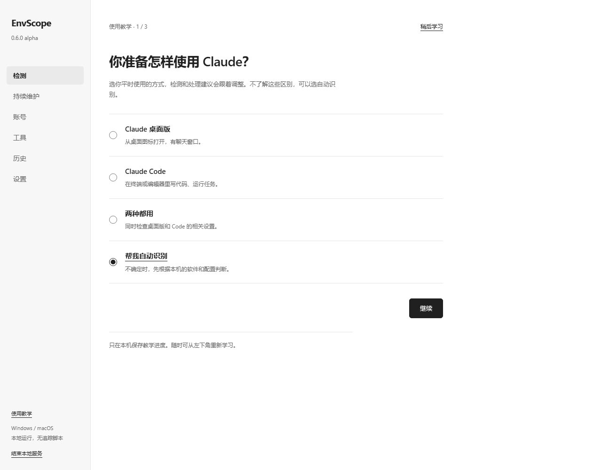

# 让 Claude 稳定可用

0.8 起默认是独立软件。关闭窗口后，可从 Windows 托盘或 macOS 菜单栏再次打开；
再次双击程序会唤回已有窗口。退出请用托盘菜单或窗口内退出按钮。
“设置 → 软件与后台”控制驻留与每日更新检查，下载、安装和重启前会说明并确认。
后台驻留不会自动安装维护任务，也不会自动修复网络。下面旧端口说明仅适用于浏览器兼容模式。

首页的环境结论只评价列出的基本使用条件：有确定问题时先修复，关键结果缺失时补全，
所列条件通过后才显示范围内合格。“不适用”是已经检查过当前用途；“本版未支持”
是软件能力缺口，申请更多权限也无效。两者都不是隐私检测通过。
“需要读取权限”只在系统明确拒绝时出现；点击查看用途，打开对应系统入口，
由用户授予读取权限后重新检测。程序不会把打开设置当成已经授权。

0.7.1：左侧“全部检查”可随时查看 32 项目录，检测后按分类或状态筛选；工具页环境
信息直接显示在按钮下方，不会弹出额外窗口。部分信息读不到会保留已取得的部分并解释原因。

本地页面地址会随程序启动改变。顶部显示正在连接的版本与状态；页面可见时保持服务连接。
如果显示“本地服务已断开”，重新双击 EnvScope 或本地试用启动器，使用新打开的页面。
不要继续刷新已退出进程的旧端口。结束服务或页面长期不可见后，旧页可能仍留在浏览器里。

EnvScope 的使用顺序是：检查连接和配置，处理影响使用的问题，回到自己的 Claude
确认实际回复，再按需要开启日常保持。它不提供账号、节点或登录凭据。

0.7 把这些操作合在首页。一键检测后自动出方案，审核后点“确认配置并修复”，
随后自动复检；可继续打开或正常重开桌面版，长期保持也在当前页预览、启用和停用。
[查看一条龙方案界面（离线示例）](images/one-stop.png)。

“环境设置”默认按需完善 Code 连接：先核对已有本机代理，再测试候选，预览固定
HTTP(S) 连接、绕过名单整理和开启证书校验的具体影响。也可明确指定本机地址，
或取消配置完善，只修复已定位问题。明确指定后不会试用别的地址。
自定义接口、云平台和未明确更换的远程代理不自动改路；缺少可信企业证书仍须自行取得。
原有 MCP、权限及其他字段保留；相同值不会为了排版而重写。

首次打开会出现三步教学。选择桌面版、Claude Code、两者或自动识别，了解结果和
修复流程，再开始第一次检测。可以跳过，左下角“使用教学”随时重看。
教学进度存在本机 `~/.envscope/learning.private.json`，不依赖浏览器端口或 Cookie；
完成教学不会放宽账号启动条件，不会启用系统任务。

## 怎样看结果

“全部检查”在检测前显示未检测；检测开始会清除上轮状态，失败时不拿旧结果填充。
14 项基础与 18 项扩展有各自的用途、结果、下一步和保持说明；HTTP / UDP / 浏览器等
独立测量另外列出，不重复算入 32 项。查看历史或后台报告时明确标注来源和时间。

首页把当前最优先的一件事展开，说明发生了什么、为什么需要处理、接下来怎样做。
其他问题可以展开。软件与设置、连接 Claude、日常保持各自报告状态。

“还不能确认”表示本次证据不足，或当前工具不能测量这一部分；不是发现故障。
地区、语言和网络归属资料不要求你为了通过而修改。
14 项检查配有白话名称，展开后可看当前证据、具体处理方法和长期保持办法。
完整技术记录与导出仍然保留，不需要先读懂它们才能操作。

自动生成方案仍是只读。具体改动列出后，点击确认才执行；配置修改先备份，写入前
再次验证代理。配置文件或继承的连接来源变化、连接失效、方案过期时停止写入。
复检没有当前证据的项目不计为已解决。撤销入口在本次结果及工具页；后续改动会阻止覆盖。

复检中的“配置文件核对”是重新读取固定文件后与方案核对，表示文件中的设置符合方案。
项目或组织设置可能覆盖用户设置，它不证明实际进程已使用该连接，也不证明账号权限。

收到服务器回应只证明该次探测有回应。API 匿名 401 不代表密钥失效，也不证明账号可用。
你需要回到自己的 Claude 登录并发消息。“我已收到 Claude 的回复”只记录本页中的
手动确认，不改技术报告；下一次检测重新要求实际确认。

桌面用户可点“复检后打开桌面版”。操作前会重新采集本机信息，核对安装、桌面配置、
账号资料与连接条件。网页端点与 API 分开核对；403 只表明要求访问校验，不算登录成功。
"查看启动条件与处理办法"列出还需确认的内容。启动必需项未知、检测过期或有待恢复副本时不提交启动。

修改桌面配置后，先保存工作，再点“保存后复检并重开”。先复检，再请求正常退出，
退出后再次复检才重开。若 Claude 仍在运行，不会强制终止；请手动退出后再使用打开入口。
此操作与账号切换共用锁，不交换或首次归档账号资料。Code 用户需重开常用终端或会话。
[查看桌面打开与日常保持界面（离线示例）](images/handoff.png)。

仍不能用时，选择“一直转圈 / 登录失败 / 经常中断 / 证书错误 / Code / MCP”中的
实际现象。步骤链接到官方说明；命令提供复制，工具不会擅自运行 `/doctor`、`/mcp`
或执行 PATH 中发现的程序。

## 账号怎样使用

只有一个账号时，在 Claude 正常登录即可，无需创建槽位。账号页管理的是 Claude
桌面版资料文件夹，不是账户注册或密码管理；浏览器与 Claude Code 登录不会跟着切换。

1. 需要多个账号时，先给 A 命名，点击“检测启动条件”。
2. 检测通过后点“保存当前资料到 A”，先保存桌面应用中的工作，再确认退出与归档。
3. 给 B 命名，点“首次登录”。现有资料保留为 A，在新打开的 Claude 中手动登录另一个账号。
4. 以后通过“切换并打开”返回已有存档；“当前资料”不等于登录仍然有效。

添加显示名称只保存本机备注，不创建账号、不登录、不自动启动。切换前重新检测；
未通过时显示原因，不交换资料。发现未完成事务时保留所有副本并停止切换。
目录导出包含未加密的登录资料，空槽位导入仅用于本人受保护的本机备份。

## 怎样保持

定时复检、Code 配置保持、系统基线和进程守护可分别审核。定时复检默认关闭；
可选每 5 / 15 / 60 分钟检查，后台结果显示实际完成时间。
Code 配置保持需要先验证当前代理、预览批准字段再启用，每次恢复先备份。
时区与地区格式需先配置到已确认城市目标。Mac 选择时区守护时，可在同一方案中
申请原生系统服务授权，每 60 秒检查；地区修改和撤销同步服务基线。遇到旧任务冲突
先按界面说明处理，不让两个基线互相覆盖。[系统时区守护说明](TIMEZONE_SERVICE.md)。
需要进程保护时，另行审核原生 10 秒守护的进程与连接范围；该功能可能停止应用和
中断未保存工作，不等于防火墙断网。Clash Verge 路由可在维护页预览、确认、读回与撤销。
更换代理或改变检测目标后重新检测，并重新生成维护方案。

## 开源方案怎样配合

| 项目 | EnvScope 中的实际用途 | 边界 |
|---|---|---|
| [claude-switcher](https://github.com/YOURSJEYO/claude-switcher) | 完整固定源码随附，维护操作适配，逐项检测对照 | 安装与修复单独确认；上游输出不直接算本工具通过 |
| [Mihomo 文档接口](https://wiki.metacubex.one/api/) | 本机读取运行配置、规则和节点；经确认可选择已有节点并验证，路由修复后读回 | 不捆绑内核、不创建节点；未确认时不修改，不兼容或未授权则说明原因 |
| [Clash Verge Rev](https://github.com/clash-verge-rev/clash-verge-rev) | 可选 Windows/macOS 外部客户端，代理发现、端口测试与原生路由维护 | 需单独安装；修改先预览并确认，保留备份、失败回滚，不内置连接服务 |

优先使用已安装的工具；增加项目名称本身不会增加检测证据。Scrapling 只在开发研究时
采集与核对公开方案。第三方界限见 [来源说明](../THIRD_PARTY_NOTICES.md)。

官方依据：[网络与证书配置](https://code.claude.com/docs/en/network-config)、
[/doctor 与稳定性排障](https://code.claude.com/docs/en/troubleshooting)、
[MCP](https://code.claude.com/docs/en/mcp)。
